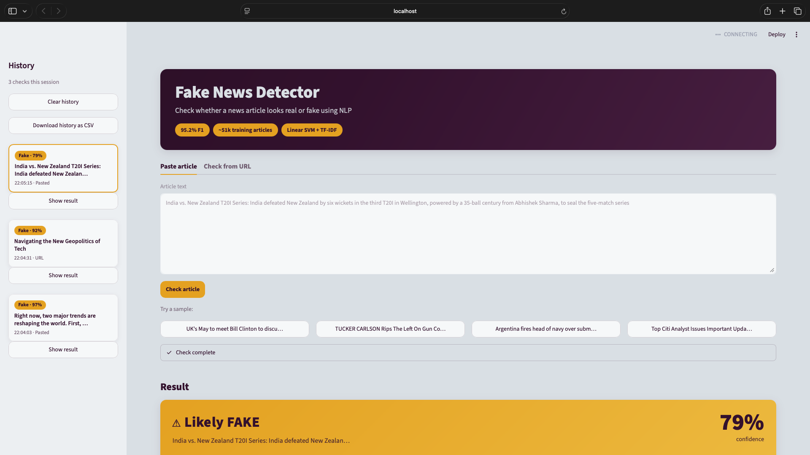

# Fake News Detection using NLP

Classifying news articles as real or fake using NLP techniques on the WELFake dataset.
A TF-IDF + Linear SVM model is trained in Jupyter notebooks and served in a Streamlit web app that explains every prediction.

## Features

- **Paste text:** paste any news article and check it.
- **Check from URL:** enter a link and the app downloads the article text for you.
- **Demo samples:** try ready-made real and fake articles with one click.
- **Real/Fake verdict:** a clear verdict with a confidence meter.
- **LIME word highlights:** see which words pushed the article towards real or fake.
- **Session history:** every check is saved in the sidebar and can be downloaded as a CSV file.



## Approach

1. **Cleaning and leakage removal:** joined title and text, dropped short and duplicate articles, and removed publisher names, datelines and image credits (like "Reuters" or "The New York Times") so the model can't cheat by reading the source.
2. **NLTK preprocessing:** lowercasing, removing URLs, HTML and non-letters, removing stopwords (but keeping negations like "not") and lemmatizing.
3. **TF-IDF features:** single words and word pairs (1-2 grams), keeping the 50,000 most frequent terms.
4. **4 models compared:** Logistic Regression, Naive Bayes, Passive Aggressive and Linear SVM.
5. **Tuning and calibration:** the best model, Linear SVM, was tuned with GridSearchCV (3-fold, F1 score) and then calibrated with `CalibratedClassifierCV` to give confidence percentages.
6. **LIME:** explains each single prediction by showing the most important words.

## Results

Test set scores (fake = positive class), from [reports/results_classical.csv](reports/results_classical.csv):

| Model | Accuracy | Precision | Recall | F1 | ROC-AUC | Train time (s) |
|---|---|---|---|---|---|---|
| Linear SVM | 0.9411 | 0.9348 | 0.9349 | 0.9349 | 0.9854 | 1.62 |
| Passive Aggressive | 0.9355 | 0.9308 | 0.9262 | 0.9285 | 0.9832 | 0.57 |
| Logistic Regression | 0.9320 | 0.9232 | 0.9268 | 0.9250 | 0.9805 | 0.72 |
| Naive Bayes | 0.8568 | 0.8181 | 0.8789 | 0.8474 | 0.9303 | 0.02 |
| Tuned Linear SVM | 0.9416 | 0.9350 | 0.9360 | 0.9355 | 0.9856 | 32.5293 |

**Final model used in the app** (calibrated Linear SVM + TF-IDF, C = 0.5), from [models/model_info.json](models/model_info.json):

| Accuracy | Precision | Recall | F1 | Train rows | Test rows |
|---|---|---|---|---|---|
| 0.9408 | 0.9319 | 0.9377 | 0.9348 | 50,822 | 12,706 |

These scores are after removing website boilerplate (image credits, "Via:" lines, embedded tweets, page buttons and author sign-offs) from the articles. An earlier version that still had this boilerplate scored a higher F1 of 0.9517, but part of that came from recognising the website instead of the writing.

Figures:

- [Model comparison](reports/figures/model_comparison.png)
- [Confusion matrices](reports/figures/confusion_matrices.png)
- [Top words for real and fake](reports/figures/top_words.png)

## How to run the app

You need Python 3.12 or newer.

1. Clone the project, then create and activate a virtual environment:

   ```bash
   git clone https://github.com/tanishqqjoshii-sys/Fake-News-Detection.git
   cd Fake-News-Detection
   python3 -m venv .venv
   source .venv/bin/activate        # Windows: .venv\Scripts\activate
   ```

2. Install the packages:

   ```bash
   pip install -r requirements.txt
   ```

3. Download the dataset and put it in the `data/` folder:
   - Source: the **WELFake dataset** on Kaggle (search "WELFake").
   - File: `WELFake_Dataset.csv` with 72,134 articles.
   - Labels: `1` = fake, `0` = real.
   - The `data/` folder is not committed to the repository, so you need to download the file yourself.

4. Run both notebooks from top to bottom, in order:
   - `notebooks/01_eda.ipynb` cleans the data and creates `train.csv` and `test.csv`.
   - `notebooks/02_classical_models.ipynb` trains and evaluates the models, and its last cell saves `models/fake_news_model.joblib`.

5. Start the app:

   ```bash
   streamlit run app/app.py
   ```

   It opens in your browser at http://localhost:8501. Paste an article, try one of the samples, or check an article from a URL.

## Project structure

```
Fake-News-Detection/
├── .streamlit/
│   └── config.toml              # Streamlit theme settings
├── app/
│   ├── app.py                   # Streamlit app
│   ├── preprocess.py            # clean_text(), shared by notebooks and app
│   ├── samples.json             # demo articles
│   ├── style.css                # app styling
│   └── utils.py                 # helper functions for the app
├── data/                        # dataset and splits (not committed)
├── models/
│   ├── fake_news_model.joblib   # saved model (not committed, created by notebook 2)
│   └── model_info.json          # test scores of the saved model
├── notebooks/
│   ├── 01_eda.ipynb             # data loading, EDA, cleaning and split
│   └── 02_classical_models.ipynb  # preprocessing, models, tuning, explainability
├── reports/
│   ├── best_params.json         # best settings from tuning
│   ├── results_classical.csv    # model comparison table
│   └── figures/                 # all saved plots and LIME explanations
├── .gitignore
├── README.md
└── requirements.txt
```

## Limitations

- The model checks **writing style, not facts**. A well-written false story can be marked real, and a badly written true story can be marked fake.
- It works on **English only**.
- News topics change over time, so the model **needs retraining** with newer articles to stay accurate.

## Future scope

- **Fact verification:** compare claims in an article with trusted sources.
- **Hindi and multilingual models:** support news in other languages.
- **Transformer models:** try models like DistilBERT, which understand context better than word counts.
